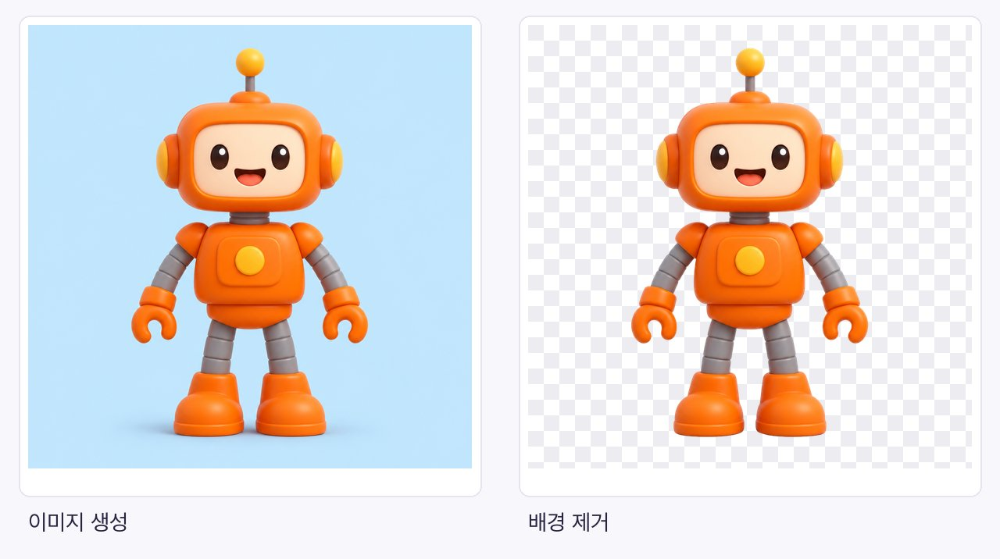
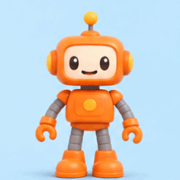
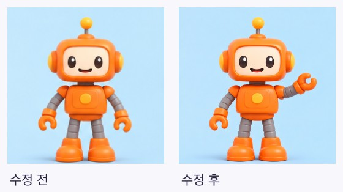
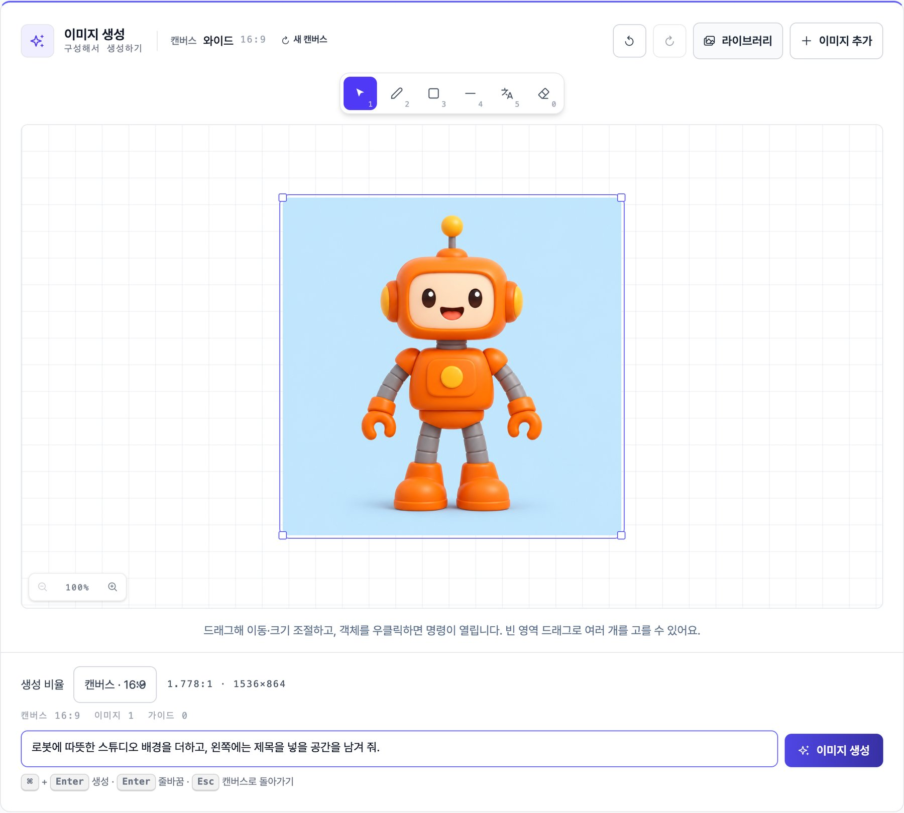

<p align="center">
  <a href="https://www.pixelbankstudio.com">
    
  </a>
</p>

<h1 align="center">PixelbankStudio Plugin</h1>

<p align="center"><a href="README.md">English</a> · <strong>한국어</strong></p>

<p align="center">Codex와 Claude Code에서 대화로 이미지와 애니메이션을 만들어 보세요.</p>

<p align="center">
  <a href="https://www.pixelbankstudio.com">PixelbankStudio</a> ·
  <a href="#빠른-시작">빠른 시작</a> ·
  <a href="#사용-예시">사용 예시</a> ·
  <a href="https://github.com/haandol/pixelbank-plugin/issues">도움말·피드백</a>
</p>

문장이나 이미지 한 장으로 시작하세요. 이미지를 만들고 배경을 지우거나, 캐릭터에 움직임을 더할 수 있습니다. 결과를 PixelbankStudio 라이브러리에 저장해 다음 작업에서도 다시 사용하세요.

## 빠른 시작

**Bun 1.4.2 이상**, **macOS 또는 Linux**, PixelbankStudio 계정과 Codex 또는 Claude Code가 필요합니다.

### Bun이 없다면 먼저 설치하세요

설치된 버전을 확인합니다.

```sh
bun --version
```

Bun이 없거나 1.4.2보다 오래된 버전이라면 [공식 설치 프로그램](https://bun.sh/docs/installation)으로 검증된 버전을 설치하세요.

```sh
curl -fsSL https://bun.sh/install | bash -s "bun-v1.4.2"
```

Linux에서 설치하려면 `unzip`이 필요합니다. 새 터미널에서 `bun --version`을 다시 확인한 뒤, Codex나 Claude Code를 재시작해 Bun을 찾을 수 있게 합니다.

<details>
<summary><strong>어시스턴트가 Bun을 찾지 못하면 어떻게 하나요?</strong></summary>

새 터미널에서 `bun --version`과 `command -v bun`을 확인한 뒤 어시스턴트를 완전히 종료하고 다시 여세요. CLI 호스트는 그 터미널에서 실행하면 됩니다. MCP 설정을 직접 관리한다면 `command -v bun`이 알려주는 실행 파일의 절대 경로를 명령으로 지정할 수 있습니다. 자세한 내용은 [Bun 설치 문제 해결](https://bun.sh/docs/installation)을 확인하세요.

</details>

### Codex

```sh
codex plugin marketplace add haandol/pixelbank-plugin
codex plugin add pixelbank@pixelbank
```

### Claude Code

```sh
claude plugin marketplace add haandol/pixelbank-plugin
claude plugin install pixelbank@pixelbank
```

설치한 뒤 어시스턴트에게 이렇게 말해 보세요.

> 내 PixelbankStudio 계정을 연결해 줘.

브라우저에서 로그인을 마치고 돌아와 연결 상태를 확인해 달라고 요청하면 됩니다.

## 사용 예시

아래처럼 요청해 보세요. 예시에 사용한 이미지와 GIF는 로컬 MCP 테스트에서 실제 이미지·애니메이션 처리를 실행해 얻은 결과입니다.

### 이미지를 만들고, 다시 활용하기

> 하늘색 배경에 친근한 주황색 장난감 로봇을 만들어 줘. 그 이미지에서 배경을 지워서 로봇만 따로 쓸 수 있게 해줘.



체크 무늬는 투명한 영역을 보여줍니다. 이미지의 일부만 분리하거나, 결과를 2배·4배로 확대하고 저장된 원본을 내려받을 수도 있습니다.

### 캐릭터에 움직임 더하기

> 이 로봇이 손을 한 번 흔들고 처음 자세로 돌아오게 해줘.

<p align="center">
  
</p>

*하늘색 배경의 원본 이미지를 16프레임 GIF로 만든 결과입니다.*

### 한 프레임만 고치기

> 첫 번째 프레임에서 로봇의 왼손을 조금 들어 줘. 나머지 프레임은 그대로 두고.



이 테스트에서는 선택한 프레임만 교체됐고, 나머지 15개는 기존 이미지를 유지했습니다. 새 이미지를 생성하지 않고 원하지 않는 프레임을 제외해 GIF를 다시 조합할 수도 있습니다.

## 편집기로 이어가기

이미지를 직접 배치하거나 선택 영역을 다듬고 싶다면 PixelbankStudio 웹 편집기로 이어가세요.

> 이 로봇 이미지를 PixelbankStudio에서 열어 줘. 배치를 직접 조정하고 싶어.

어시스턴트가 이미지와 프롬프트 초안을 준비해 편집기를 열 수 있습니다. 편집기에서 레이어를 옮기거나 크기를 바꾸고, 시각적인 지시를 추가하세요.



*테스트 이미지를 웹 편집기에 불러온 화면입니다. 화면의 프롬프트는 아직 실행하지 않은 초안입니다.*

준비된 작업공간을 여는 것만으로는 크레딧이 차감되지 않습니다. 링크를 다시 열면 처음 준비한 설정이 복원되며, 이후 캔버스 수정 사항이 그 링크에 자동 저장되지는 않습니다. 여러 단계를 이어서 작업할 때는 음식 홍보·제품 배경·배너 워크플로를 요청해 입력과 선택한 결과를 함께 관리할 수 있습니다.

## 알아두면 좋은 내용

<details>
<summary><strong>AI API 키를 따로 준비해야 하나요?</strong></summary>

아니요. 브라우저 로그인으로 PixelbankStudio 계정을 연결하면 됩니다. 비밀번호나 토큰을 대화에 입력하지 마세요.

</details>

<details>
<summary><strong>크레딧은 언제 사용하나요?</strong></summary>

어시스턴트가 처리 전에 현재 가격과 무료 사용 가능 횟수를 확인합니다. PixelbankStudio에서 자동 승인을 켜지 않았다면 크레딧을 쓰기 전에 승인을 요청합니다. 무료 사용 가능 여부를 확인하지 못해 유료 처리로 전환할 때는 별도 승인이 필요합니다. 조회·견적 확인·편집기 작업공간 준비와 열기에는 크레딧이 들지 않습니다. 자세한 내용은 [요금 안내](https://www.pixelbankstudio.com/pricing)를 확인하세요.

크레딧이 부족하면 어시스턴트가 부족 상황을 설명하고 크레딧 구매 페이지를 열며 클릭 가능한 링크도 남깁니다. 웹사이트에서 충전을 마친 뒤 원래 요청을 계속해 달라고 하세요.

</details>

<details>
<summary><strong>어떤 기능과 파일을 지원하나요?</strong></summary>

이미지·애니메이션, 저장된 이미지 워크플로와 준비된 웹 작업공간을 지원합니다. 로컬에서 올릴 수 있는 형식은 PNG·JPEG·WebP이며, 한 변당 최대 2048픽셀, 파일당 최대 5 MiB입니다. 공간·프리비주얼라이제이션·영상 실행 기능은 아직 이 플러그인에 포함되지 않습니다.

</details>

<details>
<summary><strong>연결을 끊거나 도움을 받으려면요?</strong></summary>

“PixelbankStudio 연결을 해제해 줘”라고 요청하고 정리가 완료됐다는 응답을 확인하세요. 작업이 중단됐다면 바로 다시 제출하기보다 기존 작업 상태를 확인해 달라고 요청하세요. [사용·복구 가이드](plugins/pixelbank/README.ko.md)와 [이슈 페이지](https://github.com/haandol/pixelbank-plugin/issues)에서 도움을 받을 수 있습니다.

</details>

기여자를 위한 [개발 문서](docs/README.ko.md)도 제공합니다.
