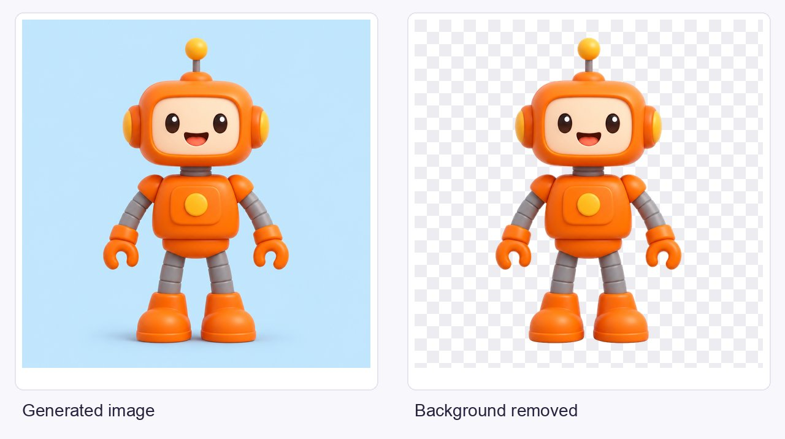
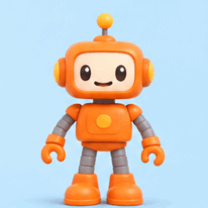
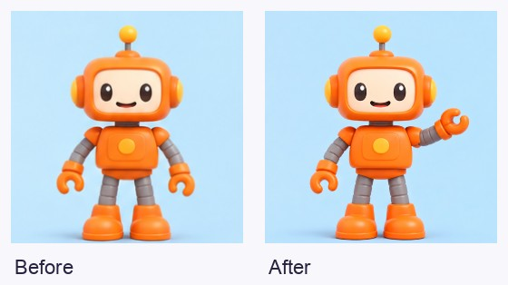
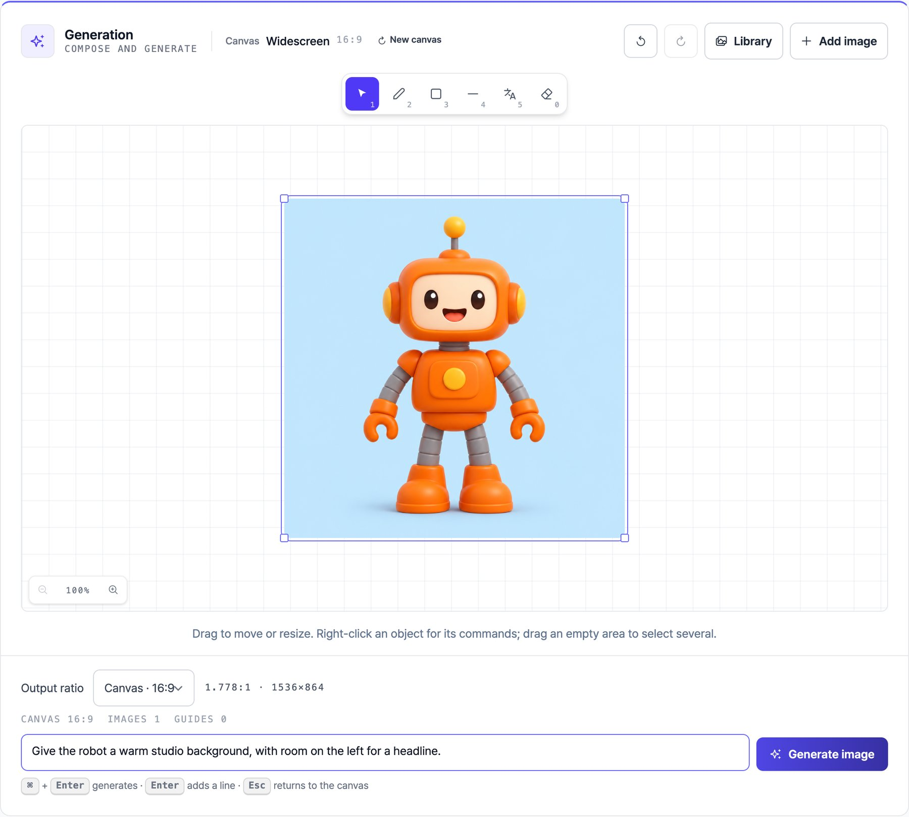

<p align="center">
  <a href="https://www.pixelbankstudio.com">
    
  </a>
</p>

<h1 align="center">PixelbankStudio Plugin</h1>

<p align="center"><strong>English</strong> · <a href="README.ko.md">한국어</a></p>

<p align="center">Make images and animations from Codex or Claude Code.</p>

<p align="center">
  <a href="https://www.pixelbankstudio.com">PixelbankStudio</a> ·
  <a href="#quickstart">Quickstart</a> ·
  <a href="#examples">Examples</a> ·
  <a href="https://github.com/haandol/pixelbank-plugin/issues">Help & feedback</a>
</p>

Start with a prompt or a picture. Generate an image, remove its background, or turn a character into an animation. Save your results in PixelbankStudio and use them again in your next project.

## Quickstart

You'll need **Bun 1.4.2 or newer**, **macOS or Linux**, a PixelbankStudio account, and Codex or Claude Code.

### Install Bun if needed

Check your installed version:

```sh
bun --version
```

If Bun is missing or older than 1.4.2, install the verified version with the [official installer](https://bun.sh/docs/installation):

```sh
curl -fsSL https://bun.sh/install | bash -s "bun-v1.4.2"
```

Linux needs `unzip` for the installer. Open a new terminal and run `bun --version` again, then restart Codex or Claude Code so it can find Bun.

<details>
<summary><strong>The assistant cannot find Bun. What should I do?</strong></summary>

Run `bun --version` and `command -v bun` in a new terminal, then fully quit and reopen your assistant. For a CLI host, launch it from that terminal. If you maintain a manual MCP configuration, use the absolute executable path returned by `command -v bun` as its command. See [Bun installation troubleshooting](https://bun.sh/docs/installation).

</details>

### Codex

```sh
codex plugin marketplace add haandol/pixelbank-plugin
codex plugin add pixelbank@pixelbank
```

### Claude Code

```sh
claude plugin marketplace add haandol/pixelbank-plugin
claude plugin install pixelbank@pixelbank
```

Then ask your assistant:

> Connect my PixelbankStudio account.

Finish signing in in your browser, then ask the assistant to check the connection.

## Examples

Try prompts like these. The previews come from a real local MCP test run with live image and animation processing.

### Create an image, then reuse it

> Make a friendly orange toy robot on a pale blue background. Then remove the background so I can use the robot on its own.



The checkerboard shows transparency. You can also isolate part of an image, enlarge a result by 2× or 4×, and download the saved original.

### Bring a character to life

> Make this robot wave once, then return to its starting pose.

<p align="center">
  
</p>

*The original blue-background image, animated into a 16-frame GIF.*

### Change one frame

> In the first frame, raise the robot's left hand a little. Keep the other frames as they are.



In this test, only the selected frame was replaced; the other 15 kept their saved images. You can also leave out unwanted frames and rebuild the GIF without generating new ones.

## Continue in the editor

To arrange an image or refine a selection by hand, continue in PixelbankStudio's web editor.

> Open this robot image in PixelbankStudio so I can adjust the layout.

The assistant can prepare your images and draft prompt before opening it. You can then move layers, resize them, or add visual instructions.



*The test image loaded into PixelbankStudio's web editor. The draft instruction has not been submitted.*

Opening a prepared workspace doesn't spend credits. Its link restores the initial setup; later canvas edits aren't autosaved by that link. For a longer task, ask for a food-promotion, product-background, or banner workflow to keep its inputs and selected results together.

## A few useful details

<details>
<summary><strong>Do I need my own AI API keys?</strong></summary>

No. Connect your PixelbankStudio account through browser sign-in. Keep passwords and tokens out of the conversation.

</details>

<details>
<summary><strong>When are credits used?</strong></summary>

The assistant checks the current price and available free uses before processing. It asks before spending credits unless you've enabled automatic confirmation in PixelbankStudio. If free-use availability can't be checked, a paid fallback still needs your approval. Browsing, quotes, and preparing or opening an editor workspace don't spend credits. See [pricing](https://www.pixelbankstudio.com/pricing).

</details>

<details>
<summary><strong>What does the plugin support?</strong></summary>

Images, animations, saved image workflows, and prepared web workspaces. Local uploads accept PNG, JPEG, and WebP up to 2048 pixels per side and 5 MiB. Space, previsualization, and video execution aren't available through this plugin yet.

</details>

<details>
<summary><strong>How do I disconnect or get help?</strong></summary>

Ask “Disconnect PixelbankStudio” and wait for confirmation that cleanup is complete. If an operation is interrupted, ask the assistant to check the existing job before retrying. See the [usage and recovery guide](plugins/pixelbank/README.md) or [open an issue](https://github.com/haandol/pixelbank-plugin/issues).

</details>

For contributors: [development documentation](docs/README.md).
